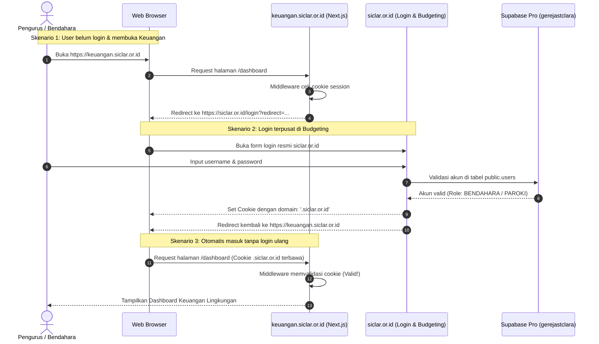

# Panduan Implementasi: Subdomain SSO (`keuangan.siclar.or.id`)

Dokumen ini merinci langkah teknis implementasi **Cara 3 (Subdomain SSO)** untuk menyatukan **Sistem Budgeting** (`siclar.or.id`) dan **Sistem Keuangan Lingkungan** (`keuangan.siclar.or.id`) di bawah satu naungan domain resmi **`siclar.or.id`** dan satu database Supabase Pro.

---

## 🏛️ Arsitektur & Alur Kerja SSO



---

## 📋 Tahapan Langkah Kerja

### 🌐 Bagian 1: Pengaturan Domain & DNS (Vercel & Registrar)

Langkah ini dilakukan untuk mengaktifkan alamat `keuangan.siclar.or.id`:

1. **Di Dashboard Vercel**:
   - Buka project **Sistem Keuangan Lingkungan**.
   - Masuk ke tab **Settings** $\rightarrow$ **Domains**.
   - Masukkan nama domain: **`keuangan.siclar.or.id`**, lalu klik tombol **Add**.
2. **Di DNS Provider Domain `siclar.or.id`** (tempat paroki mengelola domain):
   - Buka menu **DNS Management**.
   - Tambahkan 1 baris record DNS:
     - **Type**: `CNAME`
     - **Name / Host**: `keuangan`
     - **Value / Target**: `cname.vercel-dns.com`
     - **TTL**: `Auto` atau `3600`
   - Tunggu 1–5 menit hingga Vercel menampilkan status centang hijau: `Valid Configuration`.

---

### 💻 Bagian 2: Penyesuaian di Project Budgeting (`siclar.or.id`)

Agar session login dari halaman budgeting bisa terbaca oleh subdomain `keuangan.siclar.or.id`, ada 2 penyesuaian kecil di project Budgeting:

#### 1. Atur Scope Cookie saat Login ke `.siclar.or.id`
Di file tempat budgeting mengatur cookie login (misal `actions.ts` atau API route login budgeting):
Tambahkan opsi `domain: '.siclar.or.id'`:

```typescript
// Contoh di Server Action / Route Login Budgeting
cookies().set('siclar_session_token', token, {
  httpOnly: true,
  path: '/',
  domain: '.siclar.or.id', // <-- KUNCI SSO: tanda titik di depan membuat cookie berlaku di *.siclar.or.id
  secure: true,
  sameSite: 'lax',
})
```

#### 2. Tangani Parameter `?redirect=`
Di halaman login budgeting, baca query parameter `redirect`:
- Jika ada parameter `?redirect=https://keuangan.siclar.or.id`:
  Setelah login berhasil, sistem langsung mengalihkan pengguna kembali ke `https://keuangan.siclar.or.id`.
- Jika tidak ada:
  Tetap masuk ke dashboard budgeting seperti biasa.

---

### 🛡️ Bagian 3: Penyesuaian di Project Keuangan Lingkungan (`sistem-keuangan`)

Bagian ini yang kita kerjakan pada repositori Keuangan Lingkungan:

#### 1. Middleware Auth Guard (`middleware.ts`)
Jika pengguna belum login, middleware otomatis melempar ke halaman login resmi budgeting:

```typescript
// middleware.ts di Sistem Keuangan Lingkungan
import { NextResponse, type NextRequest } from 'next/server'

export async function middleware(request: NextRequest) {
  const pathname = request.nextUrl.pathname

  // Abaikan file statis, aset, dan favicon
  if (
    pathname.startsWith('/_next') ||
    pathname.startsWith('/api') ||
    pathname.startsWith('/favicon.ico')
  ) {
    return NextResponse.next()
  }

  // Periksa apakah ada tiket session login bersama (.siclar.or.id)
  const sessionUser =
    request.cookies.get('demo_user_email')?.value ||
    request.cookies.get('demo_user_username')?.value ||
    request.cookies.get('sb-lbbvcijdnmgxjggxvgqu-auth-token')?.value

  // Jika belum login dan mencoba membuka area terlindungi
  if (!sessionUser && pathname.startsWith('/dashboard')) {
    // Alihkan ke halaman login terpusat di siclar.or.id
    const isProduction = request.nextUrl.hostname.includes('siclar.or.id')
    if (isProduction) {
      const loginUrl = new URL('https://siclar.or.id/login')
      loginUrl.searchParams.set('redirect', request.nextUrl.href)
      return NextResponse.redirect(loginUrl)
    } else {
      // Di localhost tetap gunakan /login lokal untuk dev
      return NextResponse.redirect(new URL('/login', request.url))
    }
  }

  return NextResponse.next()
}
```

#### 2. Tombol Navigasi Penyeberangan (App Switcher) di Navbar
Di Navbar Sistem Keuangan Lingkungan, kita pasang tombol **"Portal SICLAR"**:
- 📊 **Sistem Keuangan Lingkungan** *(Sedang Aktif)*
- 💳 **Sistem Budgeting Paroki** $\rightarrow$ link ke `https://siclar.or.id`
- 🏢 **Sistem Manajemen Gedung** *(Label: Segera Hadir)*

#### 3. Logika Logout Bersama (*Unified Logout*)
Saat pengguna menekan tombol *Keluar (Logout)* di Keuangan Lingkungan:
Sistem menghapus cookie dengan parameter `domain: '.siclar.or.id'` dan mengarahkan kembali ke `https://siclar.or.id/login`.

---

## 🧪 Skenario Pengujian & Verifikasi

Setelah seluruh langkah di atas selesai, lakukan 3 skenario tes:

| No | Skenario Pengujian | Hasil yang Diharapkan | Status |
|---|---|---|---|
| **1** | Buka `https://siclar.or.id` $\rightarrow$ login dengan akun `paroki` $\rightarrow$ buka tab baru ke `https://keuangan.siclar.or.id` | **Langsung masuk** ke dashboard Keuangan Lingkungan tanpa perlu login ulang. | ⏳ Menunggu Tes |
| **2** | Buka browser baru (Incognito) $\rightarrow$ langsung buka `https://keuangan.siclar.or.id/dashboard` | **Otomatis di-redirect** ke halaman login `https://siclar.or.id/login`. | ⏳ Menunggu Tes |
| **3** | Di Navbar Keuangan Lingkungan, klik dropdown **SICLAR** $\rightarrow$ pilih **Sistem Budgeting** | Berpindah mulus ke `https://siclar.or.id` dalam kondisi tetap terautentikasi. | ⏳ Menunggu Tes |
| **4** | Klik tombol **Keluar (Logout)** di salah satu sistem | Sesi di kedua sistem terhapus bersih dan kembali ke halaman login. | ⏳ Menunggu Tes |

---

## 🎯 Kesimpulan Keuntungan Cara 3:
1. **Desain Login 100% Konsisten**: Menggunakan satu desain login resmi yang sudah ada di Budgeting.
2. **Kodingan Tetap Bersih & Aman**: Tidak perlu menggabungkan file/folder proyek yang berisiko bentrok.
3. **Standar Industri**: Cara ini adalah standar resmi yang digunakan aplikasi profesional untuk arsitektur multi-layanan di bawah satu organisasi gereja.

