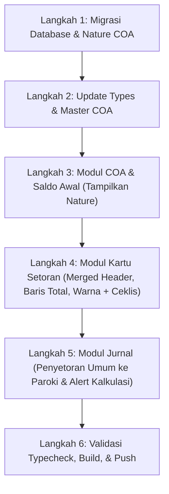

# Rencana Implementasi: Revisi Jurnal Penyetoran Paroki, Kartu Setoran, dan Kolom Nature COA

Dokumen ini berisi rencana implementasi untuk memenuhi 3 poin revisi:
1. **Modul Jurnal Transaksi**: Penyetoran kolektif ke Paroki (KK Umum), alert umat belum bayar/talangan beserta kalkulasi otomatis, dan penyesuaian teks header.
2. **Modul Kartu Setoran**: Merged header untuk tulisan *(Disajikan dalam ribuan rupiah)*, pemisahan warna status talangan vs ceklis setor paroki (`✓`), dan baris Total Bulanan di footer tabel.
3. **Modul COA & Saldo Awal**: Penambahan field `nature` di tabel `coa` database Supabase, migrasi data untuk seluruh lingkungan, dan sinkronisasi tampilan.

---

## 1. Analisis Kebutuhan & Solusi Teknis

### A. Jurnal Transaksi (Uang Keluar Penyetoran ke Paroki)
* **Permasalahan**: Saat bendahara menyetor iuran lingkungan ke Paroki (misal: Sumbangan kematian/St. Yusuf [COA 5280], ASAK [COA 5290], CYTM [COA 5360], dll.) untuk suatu periode bulan (misal: Januari), penyetoran dilakukan sekaligus untuk seluruh lingkungan secara kolektif dengan memilih Nama KK = *"Tidak spesifik / umum"*. Saat ini, penyetoran kolektif tersebut belum otomatis menandai centang di kartu setoran untuk masing-masing KK, dan belum ada kalkulasi otomatis iuran per KK.
* **Solusi**:
  1. Pada form Jurnal saat `step1Arus === 'KELUAR'`, akun setor Paroki dipilih, dan Nama KK = `umum`:
     - Tampilkan deteksi status kartu setoran bulan terpilih (berapa KK yang sudah bayar, belum bayar, atau ditalangi).
     - Jika ada umat yang belum bayar atau ditalangi: Tampilkan **alert informasi** di bawah pilihan bulan:
       > *"Perhatian: Dari [Total KK] KK, terdapat [X] KK yang belum membayar atau ditalangi pada bulan [Bulan]. Sistem otomatis mengisi nominal penuh ([Total KK] KK × Rp [Tarif] = Rp [Total]). Anda tetap dapat melanjutkan dan menyesuaikan nominal ini jika menyetor sesuai kas riil."*
     - Otomatis menghitung dan mengisi nominal default: `Jumlah KK Aktif × Nominal Iuran Standar`.
  2. Saat transaksi Uang Keluar penyetoran `umum` ini disimpan:
     - Di modul Kartu Setoran, seluruh KK yang tercatat iurannya pada bulan tersebut otomatis mendapatkan status `disetorParoki = true` (diberi tanda ceklis `✓`).

### B. Kartu Setoran (Tampilan & Footer)
* **Merged Header**:
  - Buat baris header bertingkat (*two-row super-header*):
    - Baris 1: `No` (rowSpan 2), `Kepala Keluarga` (rowSpan 2), `Periode Bulan (Disajikan dalam ribuan rupiah)` (colSpan 12, rata tengah dengan styling elegan), `Total (Rp)` (rowSpan 2).
    - Baris 2: 12 kolom nama bulan (`Jan` s.d. `Des`).
* **Warna Status Talangan vs Ceklis Setor Paroki**:
  - Warna latar belakang sel **tetap mempertahankan warna sumber pembayarannya**:
    - Hijau muda lembut untuk **Bayar Sendiri**.
    - Ungu muda lembut untuk **Kas Lingkungan**.
    - Cokelat muda lembut untuk **Donasi Umat / Ditalangi**.
  - Tanda penyetoran ke Paroki disajikan berupa **ikon ceklis tebal berwarna biru `✓`** di samping nominal tanpa menimpa warna background menjadi biru total. Dengan demikian, bendahara dapat melihat dengan jelas: *"iuran ini ditalangi (warna cokelat) dan sudah disetor ke Paroki (ada tanda ceklis ✓)"*.
* **Baris Total Bulanan di Footer (`<tfoot>`)**:
  - Menambahkan baris penutup di bagian bawah tabel yang menghitung akumulasi seluruh KK per bulan:
    - Kolom No: `-`
    - Kolom Kepala Keluarga: **Total Per Bulan** (sticky left).
    - Kolom Jan s.d. Des: Total nominal seluruh setoran di bulan tersebut (dalam ribuan rupiah).
    - Kolom Total (Rp): Akumulasi Grand Total seluruh tahun berjalan.

### C. Modul COA & Saldo Awal (Field `nature` di Database)
* **Permasalahan**: Di database Supabase tabel `coa`, saat ini baru terdapat field `id`, `nama_akun`, dan `tipe`. Keterangan fungsi akun (*nature*) hanya ada di kode lokal (`masterCoa.ts`).
* **Solusi**:
  1. Buat file migrasi SQL baru `supabase/migrations/20261030143000_add_nature_to_coa.sql`:
     - `ALTER TABLE coa ADD COLUMN IF NOT EXISTS nature TEXT;`
     - Query `UPDATE coa SET nature = ... WHERE id = ...` untuk seluruh 31 COA paroki.
  2. Update tipe data TypeScript `COA` di `src/lib/types.ts` dan `src/lib/masterCoa.ts` agar memiliki atribut `nature?: string`.
  3. Update pemuatan dan sinkronisasi COA pada `src/app/dashboard/coa-saldo/page.tsx` agar membaca field `nature` langsung dari database Supabase dan menampilkan keterangan tersebut di bawah nama akun untuk semua lingkungan.

---

## 2. Rencana Berkas yang Dimodifikasi & Dibuat

| Berkas | Peran Perubahan |
|---|---|
| `supabase/migrations/20261030143000_add_nature_to_coa.sql` *(Baru)* | Menambahkan kolom `nature` pada tabel `coa` dan mengisi deskripsi nature untuk seluruh 31 COA paroki |
| `sistem-keuangan/src/lib/types.ts` | Menambahkan properti `nature?: string` pada `interface COA` |
| `sistem-keuangan/src/lib/masterCoa.ts` | Sinkronisasi field `nature` dan mapping field `nature` dari/ke tabel `coa` Supabase |
| `sistem-keuangan/src/app/dashboard/coa-saldo/page.tsx` | Membaca dan menampilkan `nature` COA dari Supabase untuk semua lingkungan, form tambah/edit COA menyertakan `nature` |
| `sistem-keuangan/src/app/dashboard/kartu-setoran/page.tsx` | - Merged table header di atas bulan<br>- Pertahankan warna sumber (talangan/kas) dan tambahkan ceklis `✓` paroki<br>- Pengakuan penyetoran `umum` untuk seluruh KK di bulan terkait<br>- Tambahkan baris `<tfoot>` Total Bulanan |
| `sistem-keuangan/src/app/dashboard/jurnal/page.tsx` | - Deteksi Uang Keluar penyetoran `umum`<br>- Alert informatif & kalkulasi otomatis `Jumlah KK × Iuran`<br>- Sinkronisasi penandaan bulan |

---

## 3. Langkah-Langkah Eksekusi (Step-by-Step)



### Langkah 1: Migrasi Database Supabase untuk Nature COA
1. Membuat script migrasi SQL:
   - Menambahkan kolom `nature TEXT` pada tabel `coa`.
   - Mengisi nilai `nature` untuk akun kas (1100, 1200, 1300, 1400), penerimaan (4100-4900), dan pengeluaran (5100-5900).
   - Menjalankan migrasi atau menyediakan SQL yang siap dieksekusi di Supabase SQL Editor.

### Langkah 2: Pembaruan Types & Master COA
1. Di `src/lib/types.ts`, perbarui interface `COA`:
   ```typescript
   export interface COA {
     id: string;
     nama_akun: string;
     tipe: 'DEBIT' | 'KREDIT';
     nature?: string;
   }
   ```
2. Di `src/lib/masterCoa.ts`, update `syncAllCoaToDatabase` dan pemuatan dari database agar menyertakan `nature`.

### Langkah 3: Halaman COA & Saldo Awal
1. Di `src/app/dashboard/coa-saldo/page.tsx`:
   - Memastikan saat memuat daftar COA dari database Supabase, kolom `nature` dimuat dan ditampilkan di bawah nama akun.
   - Dialog Tambah/Edit COA menyimpan data ke field `nature`.

### Langkah 4: Modul Kartu Setoran
1. **Merged Header**:
   - Struktur header:
     ```tsx
     <thead>
       <tr>
         <th rowSpan={2}>No</th>
         <th rowSpan={2}>Kepala Keluarga</th>
         <th colSpan={12} className="text-center font-bold">
           Periode Bulan (Disajikan dalam ribuan rupiah)
         </th>
         <th rowSpan={2}>Total (Rp)</th>
       </tr>
       <tr>
         {SHORT_MONTHS.map(m => <th key={m}>{m}</th>)}
       </tr>
     </thead>
     ```
2. **Footer Total Bulanan**:
   - Menambahkan `<tfoot>` yang menjumlahkan nominal setoran tiap bulan dari seluruh KK:
     ```tsx
     <tfoot className="bg-slate-100 font-bold border-t-2 border-slate-300">
       <tr>
         <td className="text-center">-</td>
         <td className="sticky left-12 bg-slate-100 font-bold">Total Per Bulan</td>
         {Array.from({ length: 12 }, (_, i) => {
           const sumMonth = calculateMonthlyTotal(i + 1)
           return <td key={i} className="text-center font-mono">{formatRibuan(sumMonth)}</td>
         })}
         <td className="text-right font-mono pr-3">{grandTotalSetoran.toLocaleString('id-ID')}</td>
       </tr>
     </tfoot>
     ```
3. **Penyetoran Paroki & Warna Sel**:
   - Jika `parishDisetorMap.get('umum')?.has(mNum)` bernilai true ATAU `parishDisetorMap.get(kkId)?.has(mNum)` bernilai true: tandai `isDisetorParoki = true`.
   - Warna sel tetap memakai warna sumber (`bg-[#F6F4F0]` donasi/talangan, `bg-[#F4F3F7]` kas lingkungan, `bg-[#F2F5F3]` bayar sendiri).
   - Tanda disetor ke paroki disajikan sebagai badge ceklis biru `✓` di samping angka, sehingga tidak saling menimpa.

### Langkah 5: Modul Jurnal Transaksi
1. Di `src/app/dashboard/jurnal/page.tsx`:
   - Tambahkan pendeteksi ketika transaksi adalah Uang Keluar (`step1Arus === 'KELUAR'`) dan nama KK yang dipilih adalah `umum`.
   - Jika akun yang dipilih merupakan akun setor Paroki (misal: 5280 St. Yusuf, 5290 ASAK, 5360 CYTM, dll.) dan ada bulan yang dipilih:
     - Cari data setoran bulan tersebut di lingkungan.
     - Hitung jumlah KK yang belum bayar atau ditalangi.
     - Tampilkan alert box ringkas yang menginformasikan status pembayaran bulan tersebut dan secara otomatis mengalikan tarif iuran standar dengan jumlah KK aktif lingkungan.
     - Bendahara dapat melanjutkan dengan nominal hasil perkalian otomatis tersebut atau mengubahnya secara fleksibel.

---

## 4. Rencana Verifikasi & Pengujian

1. **Uji Typecheck & Build**:
   - Menjalankan `tsc --noEmit` untuk memastikan tidak ada kesalahan tipe TypeScript.
2. **Uji Alur Jurnal & Kartu Setoran**:
   - Input transaksi Uang Keluar COA 5280 (Sumbangan St. Yusuf) dengan KK = "Tidak spesifik / umum" untuk bulan Januari.
   - Periksa apakah muncul alert informasi dan perkalian otomatis.
   - Simpan transaksi, lalu buka Kartu Setoran: pastikan seluruh KK di bulan Januari tertandai ceklis `✓` ke Paroki.
   - Periksa bahwa KK yang memiliki donasi/talangan tetap berwarna cokelat dengan tanda bintang dan ceklis `✓`.
   - Periksa header merged column di atas bulan dan baris Total Per Bulan di paling bawah tabel.
3. **Uji COA Nature**:
   - Periksa halaman COA & Saldo Awal, pastikan kolom nature muncul di bawah nama akun dan query SQL migrasi tersedia.

